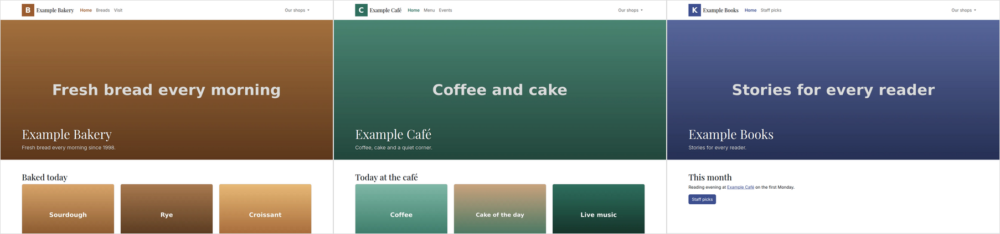

# static-multisite-generator

[English](README.md) | Magyar

Kis Python- és Jinja2-alapú generátor több statikus weboldalhoz, egyetlen forrásból. Osztott Apache-tárhelyre készült, FTP-feltöltéshez: nincs szerveroldali futtatókörnyezet, nincs Node-eszközlánc, és a build elvégzi a teljesítmény- és SEO-munkát. A repó három kitalált mintaoldallal érkezik (egy családi vállalkozás pékségével, kávézójával és könyvesboltjával).



## Funkciók

- **Több domain, egy forrás:** közös sablonok és assetek, oldalankénti felülírással; egy javítás a közös rétegben minden oldalra eljut.
- **Linkek az oldalak között:** a `link(domain, path)` azonos domainen gyökérrelatív, másik domainre abszolút `https://` linket ad, így a helyi előnézet is működik.
- **Képmunka a buildben:** minden `` megkapja a valódi `width`/`height` értékét; a fejléc képei és a `<main>` első képe `fetchpriority="high"`, a többi `loading="lazy"`; a felsorolt osztályok WebP `srcset`-változatokat kapnak.
- **Domainenként generált meta-fájlok:** `sitemap.xml`, `robots.txt`, `llms.txt` és `.htaccess` (https- és www-mentes 301, régi URL-ek átirányítása, HSTS, tömörítés, cache-fejlécek).
- **Feltöltésbarát kimenet:** a változatlan fájlok megőrzik a módosítási idejüket, a `dist/CHANGED.txt` pedig felsorolja, mit kell feltölteni és törölni az előző build óta (SHA-256 manifest alapján).
- **Cache-busting:** a CSS és JS URL-je tartalom-hash alapú verziót kap (`main.css?v=1a2b3c4d`), így egy évig cache-elhető.
- **Nincs harmadik féltől jövő kérés:** a Bootstrap, a Bootstrap Icons és a fontok az oldal saját tárhelyéről jönnek, licencnyilvántartással.
- **Ellenőrzések:** szigorú sablonváltozók, HTML-autoescape, és linkellenőrző a belső, az oldalak közötti és (opcionálisan) a külső linkekre.

## Követelmények

- Python 3.11+ (`tomllib`)
- Csak a README-előnézethez: Google Chrome (headless) és ImageMagick

## Gyors indítás

```bash
make venv        # .venv Jinja2, Pillow, requests, pytest, ruff csomagokkal (alapértelmezés: python3.12, PYTHON=... felülírja)
make build       # dist/<domain>/ minden oldalra + dist/CHANGED.txt
make check       # linkellenőrzés a dist/ mappán
make serve       # helyi előnézet: oldalanként külön port, 8001-től
```

## Parancsok

```bash
.venv/bin/python scripts/build.py [domain ...] [-q]           # az összes vagy néhány oldal buildje
.venv/bin/python scripts/check_links.py [--external]          # 0 = nincs törött link
.venv/bin/python scripts/convert_images.py <útvonal> [--max-size 1920] [--keep] [--dry-run]
.venv/bin/python scripts/serve.py [--port 8001]
make test                                                       # pytest
make lint                                                       # ruff
make preview                                                    # docs/preview.png a buildelt oldalakból
```

## Működés

```text
src/sites.toml                  domainek, nevek, kiemelőszínek, menük, régi URL-ek átirányítása
src/shared/templates/           base.html, 404.html, partials/ (head, nav, footer)
src/shared/assets/              css/, js/, img/, fonts/, vendor/ (minden oldal közös része)
src/sites/<domain>/pages/       oldalsablonok; mind a base.html-t örökli
src/sites/<domain>/assets/      oldalspecifikus assetek; azonos útvonalon felülírják a közöset
scripts/build.py                build a dist/<domain>/ mappába, manifest és változáslista
dist/                           kimenet (gitignore-olt), változtatás nélkül feltölthető
```

A build domainenként bemásolja a közös, majd az oldalspecifikus asseteket, rendereli az oldalakat, utófeldolgozza a HTML-ben a képeket, ideiglenes mappába írja a meta-fájlokat, végül a `dist/<domain>/` mappába szinkronizál úgy, hogy csak a tartalmukban változott fájlokhoz nyúl.

### Oldalak

Egy oldal egy sablon a `src/sites/<domain>/pages/` alatt:

```jinja




    <main class="container py-5">...</main>

```

- Az `index.html` a `/`, a `breads/index.html` a `/breads/`, a `visit.html` a `/visit.html` URL-t kapja.
- A `noindex = true` kihagyja az oldalt a sitemapből és az `llms.txt`-ből.
- Az `_` kezdetű fájlok részsablonok, nem oldalak.
- Oldalanként pontosan egy `<h1>` legyen, és minden kép kapjon értelmes `alt` szöveget.

### Képek

- A képeket a `scripts/convert_images.py` alakítja át (WebP, EXIF szerinti forgatás, max. 1920 px).
- Az `IMG_SIZES` listába (`scripts/build.py`) csak olyan osztály kerüljön, amelynek a CSS meghatározott szélességet ad; `width: auto` mellett a böngésző a `sizes` értékét veszi természetes szélességnek, és a kép összezsugorodik.

### Feltöltés

A `dist/<domain>/` mappát kell feltölteni a domain webgyökerébe. Az utolsó build feltöltési listája a `dist/CHANGED.txt`-ben van; az FTP-kliens „felülírás, ha újabb” módja kihagyja a változatlan fájlokat, mert azok módosítási ideje megmarad. A `.htaccess` feltöltéséhez a rejtett fájlokat is mutatni kell.

## Szerkezet

```text
scripts/    build.py, check_links.py, convert_images.py, serve.py
src/        sites.toml, shared/, sites/<domain>/
tests/      pytest tesztek (ideiglenes forrásfán futnak)
docs/       README-előnézet
```

## Ismert korlátok

- A `.htaccess` Apache-ra készül; más szervernek saját átirányítási és cache-szabályok kellenek.
- Nincs feltöltő script: a változáslista kézi vagy `lftp`-alapú feltöltéshez készül.
- A mintaképek generált helyőrzők.

## Licenc

MIT, lásd [LICENSE](LICENSE). A Bootstrap és a Bootstrap Icons (MIT), valamint az Inter és a Playfair Display font (SIL OFL 1.1) saját licencet tart meg; lásd a `LICENSES.md` fájlt a `src/shared/assets/vendor/` és a `src/shared/assets/fonts/` mappában.
